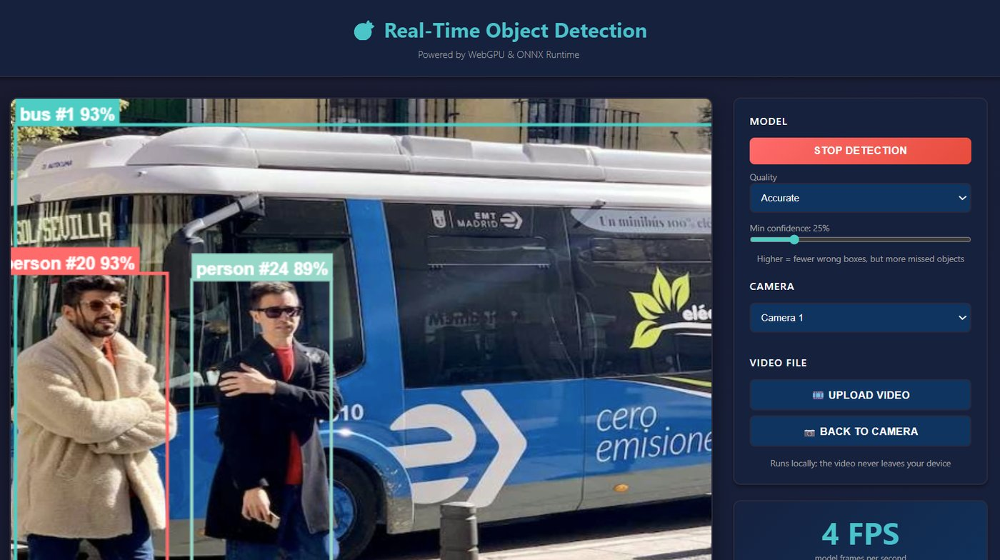

# 🎯 Real-Time Object Detection in the Browser (YOLO26 + WebGPU)

**Detect and track objects live from your webcam or a video file, entirely in your browser.** Free, open source and private: the YOLO26 / YOLOE models run on your own GPU through WebGPU and ONNX Runtime Web, so nothing is uploaded, and there's no server, no account and no install.

### ▶ [Try the live demo](https://webgpu-object-detection.vercel.app/)

[](https://webgpu-object-detection.vercel.app/)
[](LICENSE)


[](https://webgpu-object-detection.vercel.app/)

## ✨ Features

- 🚀 **Smooth Real-Time Detection**: 7–8 detections/sec on an integrated laptop GPU (Fast tier), with boxes redrawn at display rate in between
- 🔒 **Complete Privacy**: All processing happens locally; camera and video frames never leave the device
- ⚡ **WebGPU Accelerated**: Leverages GPU for maximum performance
- 📱 **Mobile Compatible**: Works on both desktop and mobile browsers
- 🎥 **Multi-Camera Support**: Switch between front/back cameras
- 🎯 **Three Quality Tiers**: Fast (YOLO26n), Accurate (YOLO26s), and More objects (YOLOE, 268 classes incl. smartwatch, glasses, earbuds, keys; you choose the list)
- 🛰️ **Object Tracking**: ByteTrack-style tracker gives each object a stable ID and smooth, gliding boxes
- 🎞️ **Video Upload**: Run detection on a local video file (e.g. traffic footage), not just the webcam
- 🎨 **Real-Time Visualization**: Live bounding boxes with class labels, track IDs and confidence scores
- 📊 **Performance Monitoring**: Real-time FPS counter and execution provider display
- 🌐 **Offline Capable**: Works without internet after initial load

## 🏗️ Architecture

### Technology Stack

- **Frontend Framework**: React 18.2 with Hooks
- **Build Tool**: Vite 5.0 (fast HMR and optimized builds)
- **AI Runtime**: ONNX Runtime Web 1.23
- **Execution Provider**: WebGPU (with multi-threaded WebAssembly fallback)
- **Models**: YOLO26n (Fast) / YOLO26s (Accurate), 80 COCO classes; YOLOE-26s (More objects), open-vocabulary. All fp16, 384×640
- **Tracking**: Lightweight ByteTrack-style IoU tracker with velocity prediction

### Project Structure

```
realTimeOD/
├── public/
│   └── models/
│       ├── importModel.py        # Exports all three models + labels.json
│       ├── model-fast.onnx       # Fast tier (YOLO26n)
│       ├── model-accurate.onnx   # Accurate tier (YOLO26s)
│       ├── model-more.onnx       # More objects tier (YOLOE-26s)
│       └── labels.json           # Class names of the More objects tier, in model order
├── src/
│   ├── components/
│   │   ├── App.jsx               # Main application component
│   │   ├── CameraView.jsx        # Video display with overlays
│   │   ├── BoundingBoxCanvas.jsx # Detection visualization
│   │   ├── Controls.jsx          # UI controls
│   │   └── FPSMonitor.jsx        # Performance metrics
│   ├── hooks/
│   │   ├── useCamera.js          # Camera management logic
│   │   └── useObjectDetection.js # Detection pipeline logic
│   ├── utils/
│   │   ├── constants.js          # Configuration and constants
│   │   ├── modelLoader.js        # ONNX model loading
│   │   ├── preprocessing.js      # Image preprocessing
│   │   ├── postprocessing.js     # NMS and output processing
│   │   └── tracker.js            # Object tracking (stable IDs)
│   ├── main.jsx                  # Application entry point
│   └── index.css                 # Global styles
├── index.html
├── package.json
├── vite.config.js
└── README.md
```

## 🚀 Quick Start

### Prerequisites

- Node.js 18+ installed
- Modern browser with WebGPU support (Chrome 113+, Edge 113+)
- Python 3.9+ only if you want to re-export the model with different classes

### Installation

1. **Clone or navigate to the project directory**:

   ```bash
   cd realTimeOD
   ```

2. **Install dependencies**:

   ```bash
   npm install
   ```

3. **(Optional) Re-export the models, e.g. with your own classes**:

   The three `public/models/model-*.onnx` files and `labels.json` are committed. To make the
   More objects tier detect different things, edit `NAMES` in `public/models/importModel.py` and run:

   ```bash
   pip install ultralytics onnxruntime
   cd public/models && python importModel.py
   ```

   This rewrites all three models + `labels.json` next to the script. Keep the
   list focused (a few hundred at most); open-vocabulary accuracy drops as it grows.

4. **Start the development server**:

   ```bash
   npm run dev
   ```

5. **Open your browser** and navigate to `http://localhost:3000`

### First-Time Usage

1. Allow camera access when prompted
2. Click **"Load Model"**. It loads the Fast model, and switches to Accurate automatically if your GPU is quick enough
3. Click **"Start Detection"** to begin real-time object detection
4. Use the camera selector to switch between devices, or **"Upload video"** to run on a file
5. Use **Quality** (Fast / Accurate / More objects) and **Min confidence** to trade speed, missed objects and wrong boxes

## 📏 Models: measured accuracy vs speed

All tiers use a 384×640 input (fits 16:9 video with little padding) and fp16 weights.
Accuracy is on 500 COCO val2017 images that none of the models were trained on; speed is
WebGPU on an Intel UHD 620 laptop iGPU (headless Chrome).

| Tier | Model | Classes | mAP50-95 | Inference | Download |
|---|---|---|---|---|---|
| Fast | YOLO26n | 80 | 0.380 | ~120 ms | 5 MB |
| Accurate | YOLO26s | 80 | 0.475 | ~270 ms | 19 MB |
| More objects | YOLOE-26s | 268 | 0.370 | ~330 ms | 21 MB |
| *(previous app)* | *yolov8n @640* | *80* | *0.393* | *~220 ms* | *13 MB* |

The confidence slider trades precision for recall (Fast tier, COCO val):

| Min confidence | Boxes that are correct | Real objects found |
|---|---|---|
| 0.2 | 72% | 48% |
| **0.25 (default)** | best balance | |
| 0.4 | 87% | 37% |
| 0.6 | 94% | 27% |

On live video, the tracker also hides any box that isn't detected in at least 2 frames,
which removes most one-frame false positives.

## 🎛️ Configuration

### Model Configuration

Edit `src/utils/constants.js` to adjust detection parameters:

```javascript
export const MODELS = {
  fast: { label: "Fast", path: "/models/model-fast.onnx", inputWidth: 640, inputHeight: 384 },
  accurate: { label: "Accurate", path: "/models/model-accurate.onnx", inputWidth: 640, inputHeight: 384 },
  more: { label: "More objects", path: "/models/model-more.onnx", labelsPath: "/models/labels.json", inputWidth: 640, inputHeight: 384 },
};

export const MODEL_CONFIG = {
  confidenceThreshold: 0.25, // Default "Min confidence" (score needed to show an object)
  lowConfidenceThreshold: 0.1, // Can only keep an already-confirmed object's box alive
  iouThreshold: 0.45, // IoU threshold for NMS
  maxDetections: 100, // Maximum number of detections
  autoUpgradeMs: 40, // Switch to Accurate if Fast runs faster than this
};
```

### Camera Configuration

Adjust camera settings in `src/utils/constants.js`:

```javascript
export const CAMERA_CONFIG = {
  defaultWidth: 640,
  defaultHeight: 480,
  idealWidth: 1280,
  idealHeight: 720,
  facingMode: "user", // 'user' for front, 'environment' for back
};
```

## 📦 Building for Production

1. **Build the application**:

   ```bash
   npm run build
   ```

2. **Preview the production build**:
   ```bash
   npm run preview
   ```

The optimized build will be in the `dist/` directory, ready for deployment.

## 🌐 Deployment

### Static Hosting (Recommended)

Deploy to any static hosting service:

- **Netlify**: Drag and drop `dist/` folder or connect Git repo
- **Vercel**: `vercel deploy`
- **GitHub Pages**: Push `dist/` to `gh-pages` branch
- **Cloudflare Pages**: Connect repo and deploy

### Important Deployment Notes

1. **HTTPS Required**: Camera access requires HTTPS in production
2. **Headers for ONNX Runtime**: Some hosts may need CORS headers configured
3. **Model Files**: Ensure the three `model-*.onnx` files and `labels.json` are included in deployment

### Example Netlify Configuration

Create `netlify.toml`:

```toml
[build]
  command = "npm run build"
  publish = "dist"

[[headers]]
  for = "/*"
  [headers.values]
    Cross-Origin-Embedder-Policy = "require-corp"
    Cross-Origin-Opener-Policy = "same-origin"
```

## 🧪 Testing Different Models

To use a different YOLO model:

1. Export any Ultralytics YOLO detect/seg model (v8, 11, 26, YOLOE) to ONNX. For YOLO26 pass `end2end=False`
2. Place it in `public/models/`, plus a labels JSON (array of class names) if it isn't an 80-class COCO model
3. Update `path`, `inputWidth`, `inputHeight` (and `labelsPath` if needed) of a tier in `MODELS` (`src/utils/constants.js`)

The output shape is read from the model, so no postprocessing changes are needed.

## 🐛 Troubleshooting

### Camera Not Working

- Ensure you're using HTTPS (or localhost)
- Check browser permissions for camera access
- Try a different browser

### Model Not Loading

- Verify the three `model-*.onnx` files exist in `public/models/`
- Check browser console for error messages
- Ensure model was exported correctly

### Low FPS

- Check if WebGPU is enabled (see execution provider in UI)
- Try reducing camera resolution
- Close other GPU-intensive applications
- Switch Quality to **Fast**
- Re-export at a smaller size in `TIERS` (`importModel.py`) and update `inputWidth`/`inputHeight` to match
- On WebAssembly, check the console says `isolated: true` (COOP/COEP headers), otherwise it runs single-threaded

### WebGPU Not Available

The app automatically falls back to WebAssembly. Performance will be lower but still functional.

To enable WebGPU:

- Chrome/Edge: Should be enabled by default in version 113+
- Firefox: Not yet supported (use WASM fallback)
- Safari: Limited support, may need enabling in settings

## 🎨 Customization

### Adding Custom Classes

Classes are baked into the model at export time. Edit `NAMES` in
`public/models/importModel.py` and re-run it (see Installation step 3).

### Changing Colors

Modify the color palette in `src/utils/constants.js`:

```javascript
export const COLORS = [
  "#FF6B6B",
  "#4ECDC4", // ... your colors
];
```

### Styling

All component styles are in separate CSS files:

- `src/App.css` - Main layout
- `src/components/*.css` - Component-specific styles

## 📊 Performance Optimization Tips

1. **Reduce Input Resolution**: Lower resolution = faster inference
2. **Adjust Confidence Threshold**: Higher threshold = fewer detections to process
3. **Optimize Camera Settings**: Lower camera resolution if not needed
4. **Close Unnecessary Tabs**: Free up GPU resources

## 🔒 Privacy & Security

- **No Data Collection**: Nothing is sent to any server
- **Local Processing**: All inference happens on your device
- **No Cookies**: The deployed site uses Vercel Web Analytics (cookieless, anonymous page views only); camera and video frames never leave the device
- **Open Source**: Fully inspectable code

## 📄 License

Apache 2.0 License - feel free to use this project for any purpose.

Note: the model weights in `public/models/` (YOLO26, YOLOE by Ultralytics) are licensed separately under AGPL-3.0.

## Acknowledgments

- [Ultralytics YOLO26](https://docs.ultralytics.com/models/yolo26/) and [YOLOE](https://docs.ultralytics.com/models/yoloe/) - Detection models (AGPL-3.0)
- [ByteTrack](https://github.com/ifzhang/ByteTrack) - Tracking approach the tracker is based on
- [ONNX Runtime Web](https://github.com/microsoft/onnxruntime) - Inference engine
- [React](https://react.dev/) - UI framework
- [Vite](https://vitejs.dev/) - Build tool

## 📞 Support

For issues, questions, or contributions:

- Open an issue on GitHub
- Check existing documentation
- Review troubleshooting section

## 🚀 Future Enhancements

Potential improvements:

- [ ] Multiple model support (e.g. RF-DETR)
- [x] Video file upload support
- [x] Object tracking
- [ ] Speed estimation / line-crossing counts for vehicles
- [ ] Screenshot/recording functionality
- [ ] Detection statistics and analytics
- [ ] Custom model training integration
- [ ] Pose estimation support
- [ ] Segmentation support

---

**Built with ❤️ for privacy-conscious AI applications**
